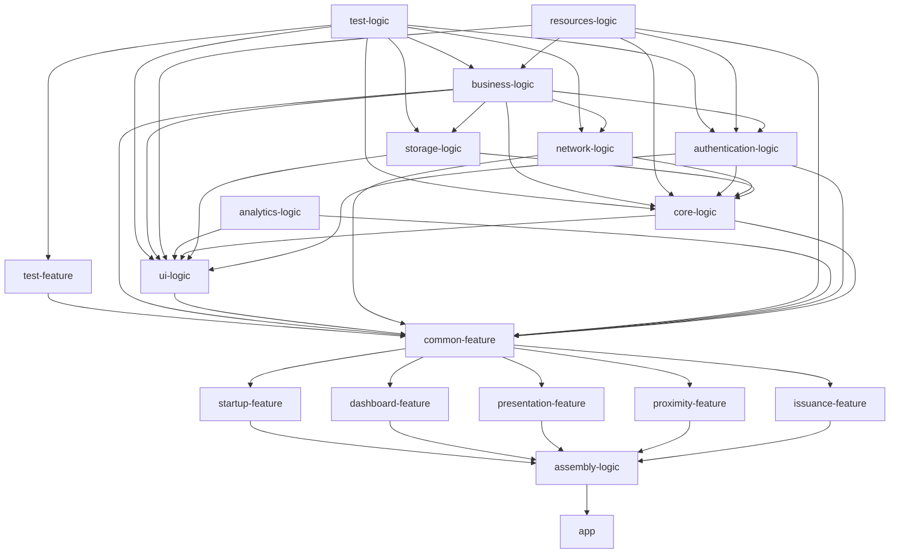

# EUDI Android Wallet reference application

:heavy_exclamation_mark: **Important!** Before you proceed, please read
the [EUDI Wallet Reference Implementation project description](https://github.com/eu-digital-identity-wallet/.github/blob/main/profile/reference-implementation.md)

----

## Table of contents

* [Overview](#overview)
* [Specifications Employed](#specifications-employed)
* [Important things to know](#important-things-to-know)
* [How to use the application](#how-to-use-the-application)
* [How to build - Quick start guide](#how-to-build---quick-start-guide)
* [Application configuration](#application-configuration)
* [Production go-live guide](#production-go-live-guide)
* [Release automation](#release-automation)
* [Package structure](#package-structure)
* [Demo videos](#demo-videos)
* [Disclaimer](#disclaimer)
* [How to contribute](#how-to-contribute)
* [License](#license)

## Overview

The EUDI Wallet Reference Implementation is built based on the [Architecture Reference Framework](https://github.com/eu-digital-identity-wallet/eudi-doc-architecture-and-reference-framework/blob/main/docs/architecture-and-reference-framework-main.md) and aims to showcase a robust and interoperable platform for digital identification, authentication, and electronic signatures based on common standards across the European Union.
The EUDI Wallet Reference Implementation is based on a modular architecture composed of business-agnostic, reusable components that will evolve in incremental steps and can be reused across multiple projects.

The EUDI Wallet Reference Implementation is the application that allows users to:

1. Obtain, store, and present PID and mDL.
2. Verify presentations.
3. Share data on proximity scenarios.
4. Support remote QES and more use cases with the modules included.

The EUDIW project provides, through this repository, an Android app. Please refer to the repositories listed in the following sections for more detailed information on how to get started, contribute, and engage with the EUDI Wallet Reference Implementation.
 
## Specifications Employed

The app consumes the EUDI [Wallet Core](https://github.com/eu-digital-identity-wallet/eudi-lib-android-wallet-core) SDK and a list of available libraries to facilitate remote presentation, proximity, and issuing test/demo functionality following the specification of the [ARF](https://github.com/eu-digital-identity-wallet/eudi-doc-architecture-and-reference-framework), including:
 
- OpenID4VP - v1 (remote presentation), DCQL
 
- ISO18013-5 (proximity presentation),
 
- OpenID4VCI v1 (issuing)

- ETSI TS 119 602 trusted lists (LoTE) for trust management — issuer trust, status-list signer
  trust, reader/verifier authentication, and the registration certificates that establish what an
  issuer or verifier is registered to do. Registration-certificate checking is a runtime setting and
  ships **off**. Credential issuer trust uses `ENFORCE` for the configured PID types and `INFORM`
  for other classified types in both reference flavors; no other type is classified there, so the
  issuer of those documents is not verified against the trusted lists, although its signature is
  still checked before the document is stored (see
  [wiki/CONFIGURATION.md](wiki/CONFIGURATION.md))
 
- Issuer functionality, to support development and testing, one can access an OID4VCI test/demo service for issuing at: 

  - [EUDI Issuer](https://issuer.eudiw.dev/)

  - [OpenID4VCI PID and mDL Issuer (python)](https://github.com/eu-digital-identity-wallet/eudi-srv-web-issuing-eudiw-py)
 
  - [OpenID4VCI PID and mDL Issuer (kotlin)](https://github.com/eu-digital-identity-wallet/eudi-srv-pid-issuer)
 
Relying Party functionality:
 
To support development and testing, one can access a test/demo service for remote presentation at:

  - [EUDI Verifier](https://verifier.eudiw.dev) 

  - [Web verifier source](https://github.com/eu-digital-identity-wallet/eudi-web-verifier)

  - [Verifier restful backend service source](https://github.com/eu-digital-identity-wallet/eudi-srv-web-verifier-endpoint-23220-4-kt)

To support proximity, the EUDI Verifier App is available [here](https://github.com/eu-digital-identity-wallet/eudi-app-multiplatform-verifier-ui) and can request PID and mDL, with reader authentication enabled.

The issuer, verifier service, and verifier app authentication are validated against the EUDIW
development trusted lists (LoTE) in both flavors — see [wiki/CONFIGURATION.md](wiki/CONFIGURATION.md). 
The `pidissuerca02_*` certificates under [`resources-logic/src/main/res/raw`](https://github.com/eu-digital-identity-wallet/eudi-app-android-wallet-ui/tree/main/resources-logic/src/main/res/raw)
remain as the RQES document-retrieval trust anchors, not reader/verifier trust anchors; `pidissuerca02_eu` also
anchors the signer of the development trusted lists (`loteSignerTrustAnchors`).

## Important things to know

The main purpose of the reference implementation is to showcase the ecosystem and act as a technical example of how to integrate and use all of the available components.

If you're planning to use this application in production, we recommend reviewing the following steps:
- Configure the application properly by following the guide [here](wiki/CONFIGURATION.md)
- Follow the production go-live guide [here](wiki/GO_LIVE.md) before creating a release candidate.
- Check that the session lock suits your assurance level: the timeouts in `AuthenticationConfig`, and the screens it
  treats as login and protected-flow screens in `ConfigUILogic`. See [wiki/GO_LIVE.md](wiki/GO_LIVE.md#authentication-and-biometrics).
- Check that the PIN storage configuration matches your security requirements, or provide your own by following [Pin Storage Configuration](wiki/CONFIGURATION.md#pin-storage-configuration).
- Make sure your application meets the OWASP MASVS industry standard. The following link describes the controls you must implement:
    - [OWASP MASVS](https://mas.owasp.org/MASVS/)
- Issuers and verifiers are trusted on two independent layers: an access certificate proves who
  they are, and a registration certificate establishes what they are registered to do. The first is
  enforced where the protocol and trust policy allow it, and otherwise raises a warning or a "not
  verified" mark. The second is governed by **Check Registration Certificates** in the app's
  Settings, which ships **off** — turn it on and issuance then requires both layers (a provider that
  cannot be authenticated, or that is not registered for the document it offers, is refused and
  nothing is stored), while on presentation the registration is shown to the user and a request
  beyond its scope requires explicit acknowledgement before sharing. A production deployment is
  expected to turn it on; see
  [wiki/GO_LIVE.md](wiki/GO_LIVE.md#registration-certificates-the-second-trust-layer) for the
  requirements that places on your backends.

Do not treat `devRelease` or `demoRelease` as production-ready artifacts. They use demo services,
demo/development trust anchors, and reference-implementation defaults that an implementer must
replace before launch.

## How to use the application

### Minimum device requirements

- API level 29 (Android 10) or higher.

### Prerequisites

You can download the application (APK file) through GitHub releases [here](https://github.com/eu-digital-identity-wallet/eudi-app-android-wallet-ui/releases)

You will also need to download the EUDI Verifier app. More information can be found [here](https://github.com/eu-digital-identity-wallet/eudi-app-multiplatform-verifier-ui)

### App launch

1. Launch the application
2. You will see the Trust Mark introduction, then a welcome screen where you will be asked to create a PIN for future logins.
   PINs that are easy to guess, such as `000000`, `123456` or `654321`, are refused. If the device has
   no screen lock, the PIN screen suggests setting one, and the login screen repeats it at each login.

Once unlocked, the Wallet locks again after 60 seconds in the background or 5 minutes without
interaction (a touch, key press or screen-reader action on any of its screens or sheets), and asks
for the PIN or a biometric. While an issuance, presentation, signing or wallet reset is in progress
it waits up to 10 minutes in the background, so that a visit to the issuer's website does not end the session.
The signing service's screens get the same 10 minutes, since the Wallet cannot see interaction
there. A link that arrives while the Wallet is locked, such as a presentation request or a
credential offer, opens after you log in; if the Wallet locked in the middle of an issuance, start
the issuance again. The proximity QR code is the exception: leaving the app there stops the
session (see the [Proximity flow](#proximity-flow)). The timeouts are set in `AuthenticationConfig`; see
[wiki/CONFIGURATION.md](wiki/CONFIGURATION.md#pin-throttle-configuration).

To log in with a biometric, turn on "Authenticate with biometrics" in "Settings": the Wallet asks
for your PIN, then for your biometric. Turning it off asks for the PIN or a biometric.

### Issuance flow (Scoped - Wallet initiated)

1. Navigate to the "Dashboard" screen, go to the "Documents" tab, and tap on the "+" icon (top-right of the screen). Select "From list". A new wallet opens the Dashboard after you set up your PIN. With `forcePidActivation` enabled in `ConfigLogic` (off by default), a wallet without documents opens this screen instead, after you set up or enter your PIN.
2. Select "PID".
3. In the web view that appears, choose "Country Selection", then "FormEU", and tap "Submit".
4. Fill in the form. Any data will suffice, but selecting a birth date older than 18 years is recommended, as it is required for certain app functionalities (e.g., RQES).
5. After submission, a success screen will appear. Tap "Close".
6. You will be redirected to the "Dashboard" screen. If this was your first document added to the Wallet, you will land on the "Home" tab; otherwise, you will be on the "Documents" tab. The flow is now complete.

### Issuance flow (Credential Offer - Issuer-initiated)

1. Go to the "Dashboard" screen, navigate to the "Documents" tab, and tap the "+" icon (top-right of the screen). Select "Scan QR".
2. Scan the QR code from the issuer's website [EUDI Issuer](https://issuer.eudiw.dev/credential_offer) (demo flavor; for the dev flavor, use the offer page of `ec.dev.issuer.eudiw.dev`)
3. Review the documents included in the credential offer and tap "Add".
4. In the web view that appears, select "Country Selection", then "FormEU", and tap "Submit".
5. Fill in the form. Any data will suffice, but selecting a birth date over 18 is recommended, as it is required for certain app functionalities (e.g., RQES).
6. After submission, a success screen will appear. Tap "Close".
7. You will be redirected back to the "Documents" tab within the "Dashboard" screen. The flow is now complete.

The offer must come from an issuer the build is configured for: `issuer.eudiw.dev` or
`issuer-backend.eudiw.dev` in the demo flavor, `ec.dev.issuer.eudiw.dev` or
`dev.issuer-backend.eudiw.dev` in the dev flavor. An offer from any other issuer stops with "This
offer comes from an issuer that this wallet is not set up to use". When the offer is included in the
link, the Wallet refuses it before contacting anyone; when the link points to the offer, the Wallet
fetches it only from a configured issuer's address, and still refuses it if it names another
issuer.

Both flows end on a success screen that shows whether the issuer was verified: the issuer carries a
verified badge only when every document added came from a trusted issuer, and each document whose
issuer was not verified says so: "Issuer trust not confirmed", "Issuer verification not performed"
or "Issuer verification unavailable". In the reference configuration only PID documents are checked
against the trusted list, so every other document shows "Issuer verification not performed", even
one from the PID's issuer. The document's details show the same.

If the issuer adds only some of the requested documents, the success screen lists the ones that were
not added. If the Wallet cannot renew a document in the background, the document's details say so,
and you can renew it there with **Reissue document**, unless the issuer has revoked or suspended
it.

With **Check Registration Certificates** enabled in Settings, both issuance flows require the
provider to be registered for what it offers: if its registration certificate is missing, cannot be
validated, or does not cover the offered document, the flow stops on an "Issuance blocked" sheet and
nothing is added to the Wallet. The same applies to re-issuance, where the document you already hold
is left untouched. With the setting off — the default — no registration is checked and none of this
applies. A change to this setting applies the next time the app starts.

The Wallet checks each document's status list in the background: once per process after you log in
(not on each return from the background), and every 15 minutes from your first login on, also while
the Wallet is closed or locked. A revoked document can no longer be presented or re-issued, and
stays blocked even if its status later reads valid; a suspended document is blocked, cannot be
re-issued, and is shown as suspended until the issuer reinstates it. If the status could not be
checked, for example while offline, the document's details say so.

### Presentation (Online authentication/Same device) flow

1. Go to the browser application on your device and enter "https://verifier.eudiw.dev"
2. Expand the Person Identification Data (PID) card and select:
    1. "Attributes by" → "Specific attributes".
    2. "Format" → Choose the format of your choice.
3. Tap "Next", then select "Select Attributes".
4. Choose the fields you want to request from the Wallet (e.g., "Family Name" and "Given Name").
5. Review your presentation request, tap "Next", and then select "Open with your Wallet".
6. When prompted to open the wallet app, tap "Open".
7. You will be redirected to the app’s "Request" screen, which shows the attributes the Verifier
   requested. These are disclosed as requested; this flow has no per-attribute selection. If the
   request can be satisfied in more than one way, choose the option you prefer.
   The screen also shows who is asking. With **Check Registration Certificates** enabled in
   Settings, that identity comes from the Verifier's registration certificate, and if the
   certificate is missing or cannot be validated, or if the request reaches beyond what the Verifier
   registered for, a warning appears and "Share" stays disabled until you acknowledge it. With the
   setting off — the default — the name comes from the Verifier's access certificate alone.
   Whatever the setting, a Verifier whose access certificate cannot be verified is refused before
   this screen, on a "Presentation blocked" sheet.
   If the request includes your portrait, a notice says that it can be used as biometric data, and
   "Share" first asks you to confirm on a "Share your portrait?" sheet.
8. Tap "Share".
9. Enter the PIN you set up during the initial steps.
10. Upon successful submission, tap "Close".
11. A browser will open, confirming that the Verifier has accepted your request.
12. Return to the app. The flow is now complete.

If the relying party rejects the response, the Wallet displays "Your response was sent to the relying
party, which then rejected it." Select **Close** or use Android Back to leave the presentation. The
Wallet returns to the screen that initiated it and opens the relying party's redirect in the browser,
if one is supplied and it is an `https` address. The same rule applies to the redirect after a
successful presentation; a redirect with any other scheme is not opened, and the Wallet never treats
it as one of its own links.

When a presentation request includes transaction data for signing, each applicable option shows a
**Data to be signed** section below its requested data. Its **Signature details** are open and list
every field of the transaction data; the signed attributes, which the relying party chooses
freely, are marked as not checked by the Wallet, and a document carried in the request is shown
as included, with its type and size. These
details are informational; sharing still uses the existing **Share** flow. Where available,
**Open document** opens the supplied document link.

Recorded signing-request information is also available under **SIGNING REQUEST → Signature details**
in the presentation's transaction details. This section is read-only and does not show one-time
passwords again.

If the relying party's registration could not be verified when you shared data with it, the
transaction's details say so, and so do the screens for asking it to delete your data or reporting
it to a data protection authority. If its registration certificate belonged to another party, the
Wallet does not offer a deletion request.

### Offering documents to apps and websites

Through the Android Digital Credential API, apps and websites can ask the Wallet for a document
with the system's own picker. The Wallet offers its documents there while **Allow document requests
from apps and websites (DC API)** is on in Settings, which is the default. Turn it off and the
Wallet removes its documents from the picker and declines such requests.

### Proximity flow

1. Log in to the EUDI Wallet app.
2. You will be on the "Home" tab of the "Dashboard" screen.
3. Tap the "Authenticate" button on the first informative card. A modal with two options will appear.
4. Select "In person".
5. You will be prompted to enable Bluetooth (if it is not already enabled) and grant the necessary permissions for the app to use it (if you have not already done so).
6. The Verifier scans the presented QR code. The code works only while the app stays in front:
   leaving the app or turning the screen off stops the session and closes the screen, and you start
   again from step 3.
7. The app's "Request" screen will load. Here, you can select or deselect which attributes to share
   with the Verifier. You must select at least one attribute to proceed. As in the remote flow, and
   only while registration-certificate checking is enabled, a reader whose registration certificate
   is missing or cannot be validated raises a warning that keeps "Share" disabled until you
   acknowledge it. A reader that sends no reader authentication, or one whose authentication cannot be
   verified, raises a warning in every configuration, and "Share" stays disabled until you acknowledge
   it. A reader that sent reader authentication that is not trusted (an invalid signature or an
   untrusted certificate) receives no data even if you share.
   If the request includes your portrait, a notice says that it can be used as biometric data. The
   portrait is selected like the other attributes; while it stays selected, "Share" first asks you
   to confirm on a "Share your portrait?" sheet.
8. Tap "Share".
9. Enter the PIN you set up during the initial steps.
10. Upon successful authentication, tap "Close".
11. The Verifier will receive the data you chose to share.
12. You will return to the "Home" tab of the "Dashboard" screen. The flow is now complete.

### Removing a document and resetting the Wallet

To remove one document, open it from the "Documents" tab and tap "Remove from wallet". The document,
its keys and the Wallet's records about it are deleted. The transaction history stays: you can delete
single entries from it, and **Reset wallet** deletes it all.

To erase everything:

1. Open "Settings" from the menu on the "Home" tab.
2. Tap "Reset wallet". A confirmation lists what will be deleted: your documents and their keys,
   your transaction history, and your PIN, settings and logs.
3. Tap "Reset", then enter your PIN or use your biometric.
4. The Wallet deletes the data and starts again as on first use: the Trust Mark introduction
   appears, then you create a new PIN. Settings return to their defaults; **Check Registration
   Certificates** shows off again and takes effect the next time the app starts.

See [wiki/GO_LIVE.md](wiki/GO_LIVE.md#data-deletion-and-factory-reset) for what each step removes.

## How to build - Quick start guide

[This document](wiki/HOW_TO_BUILD.md) describes how you can build the application and connect it to hosted or locally running issuing and verification services.

## Application configuration

You can find instructions on how to configure the application [here](wiki/CONFIGURATION.md)

## Production go-live guide

Member State teams, wallet providers, and integrators preparing a live deployment should follow the
production go-live guide [here](wiki/GO_LIVE.md). It explains how to create a production flavor,
replace demo endpoints and trust anchors, configure Wallet Core and RQES, harden the Android app,
and collect release/security evidence.

## Release automation

Fastlane lane reference is generated in [fastlane/README.md](fastlane/README.md). Human-maintained
usage notes, required environment variables, and release-lane cautions are documented in
[fastlane/USAGE.md](fastlane/USAGE.md).

## Package structure

## Demo videos

Issuance

[Issuance](https://github.com/user-attachments/assets/eeecc356-8b96-4c86-8347-7a9dd5e5251d)

Presentation

[Presentation](https://github.com/user-attachments/assets/2ffc230f-f3fd-4efb-95aa-5a536a3f86ac)

Proximity

[Proximity](https://github.com/user-attachments/assets/63da7498-1b83-4949-a058-ab086584d1c8)

## Disclaimer

The released software is an initial development release version: 
-  The initial development release is an early endeavor reflecting the efforts of a short time-boxed period, and by no means can it be considered the final product.
-  The initial development release may be changed substantially over time and might introduce new features, but also may change or remove existing ones, potentially breaking compatibility with your existing code.
-  The initial development release is limited in functional scope.
-  The initial development release may contain errors or design flaws and other problems that could cause system or other failures and data loss.
-  The initial development release has reduced security, privacy, availability, and reliability standards relative to future releases. This could make the software slower, less reliable, or more vulnerable to attacks than mature software.
-  The initial development release is not yet comprehensively documented. 
-  Users of the software must perform sufficient engineering and additional testing to properly evaluate their application and determine whether any of the open-sourced components are suitable for use in that application.
-  We strongly recommend not putting this version of the software into production use.
-  Only the latest version of the software will be supported
-  This project is tested with BrowserStack.

## How to contribute

We welcome contributions to this project. To ensure that the process is smooth for everyone
involved, follow the guidelines found in [CONTRIBUTING.md](CONTRIBUTING.md).

## License

### License details

Copyright (c) 2026 European Commission

Licensed under the EUPL, Version 1.2 or - as soon they will be approved by the European
Commission - subsequent versions of the EUPL (the "Licence"); You may not use this work
except in compliance with the Licence.

You may obtain a copy of the Licence at:
https://joinup.ec.europa.eu/software/page/eupl

Unless required by applicable law or agreed to in writing, software distributed under 
the Licence is distributed on an "AS IS" basis, WITHOUT WARRANTIES OR CONDITIONS OF 
ANY KIND, either express or implied. See the Licence for the specific language 
governing permissions and limitations under the Licence.